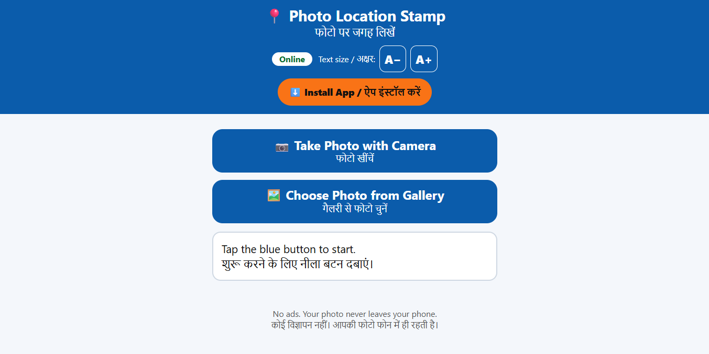

<div align="center">

# 📍 Photo Location Stamp

**Write a photo's location right on the photo. One tap. No ads. Works offline.**

फोटो पर जगह लिखें — आसान, बिना विज्ञापन, बिना इंटरनेट के भी।

[](#install-on-your-phone)
[](#how-it-works)
[](#why-this-exists)
[](#tech)
[](#license)

**[🔗 Live demo](https://geotag-green.vercel.app/)** · [Install](#install-on-your-phone) · [Deploy your own](#deploy-your-own-free)

</div>

---

## Why this exists

Most "GPS camera" and "geotag photo" apps are packed with ads, pop-ups and sign-ups. That is a real problem for **elderly and non-technical users**, who tap the wrong thing and get lost.

This app was built for my mom. It does **one job**, with big buttons, big text, and Hindi + English labels:

> Take or choose a photo → the location is written on it → save it.

No account. No ads. No tracking. No server of its own.

## Features

- 📷 **Take a photo inside the app** and stamp the location at that moment
- 🖼️ **Or choose a photo from the gallery.** The location is read from the photo's own GPS data (EXIF)
- 🏷️ **Stamps** place name, latitude/longitude, and date/time on a clear strip at the bottom of the photo
- ⬇️ **One-tap save**, plus **Share / Save to Gallery** on phones
- 📴 **Works offline.** Reading GPS and stamping need no internet (the place *name* needs internet; offline you get the GPS numbers)
- 🧓 **Made for non-tech users:** huge buttons, simple words, English + हिन्दी, step-by-step messages
- 🔠 **A− / A+ text size buttons** (remembered), so nobody has to pinch-zoom
- 📲 **Installable (PWA)** with an orange one-tap **Install App** button
- 🪶 **Zero dependencies.** Plain HTML, CSS and JavaScript. The whole app is about 6 small files

## Screenshots

<p align="center">
  
  
</p>


## How it works

1. **Read the location.** A small built-in EXIF reader (`exif.js`) finds the GPS position and date inside a JPEG. If you use the in-app camera, the phone's GPS (`navigator.geolocation`) is used instead.
2. **Find the place name.** When online, the coordinates are sent to OpenStreetMap's free [Nominatim](https://nominatim.org/) service to get a readable address. Offline, this step is skipped.
3. **Stamp the photo.** The image is drawn on an HTML `<canvas>` and the text strip is added.
4. **Save.** The canvas is exported as a JPEG and downloaded or shared.

A service worker caches the app, so after the first visit it opens and works without internet.

### Privacy

- Your **photos never leave your device**. Everything happens in the browser.
- The **only network request** is the optional place-name lookup, which sends the latitude/longitude (not the photo) to OpenStreetMap Nominatim. Skip it by staying offline.
- No analytics, no cookies, no accounts.

## Install on your phone

Open the live link in **Chrome** (Android) or **Safari** (iPhone), then:

- **Android:** tap the orange **⬇️ Install App** button, or ⋮ → *Install app* / *Add to Home screen*
- **iPhone:** tap Share ⬆ → *Add to Home Screen*

It then opens like a normal app, even with no internet.

> Camera and location need permission. Tap **Allow** when asked. The app must be opened over **HTTPS** (GitHub Pages does this automatically).

## Deploy your own (free)

**Vercel (what the live demo uses)**

1. Fork this repo: <https://github.com/Hridyanshkushwaha/Geo-Tag>
2. On [vercel.com](https://vercel.com), click **Add New → Project** and import your fork
3. Leave all settings as they are (no build step) and click **Deploy**

**GitHub Pages**

1. Fork the repo, then go to **Settings → Pages**
2. Source: **Deploy from a branch** → branch **main**, folder **/ (root)** → Save
3. Your app will be live at `https://YOUR-USERNAME.github.io/Geo-Tag/` in a minute or two

Works the same on Netlify, Cloudflare Pages or any static host that serves HTTPS.

### Run locally

```bash
git clone https://github.com/Hridyanshkushwaha/Geo-Tag.git
cd Geo-Tag
# any static server works; the camera/GPS need localhost or https
python3 -m http.server 8080
# open http://localhost:8080
```

## Project structure

```
├── index.html       # UI, camera, stamping, save/share, install button
├── exif.js          # tiny dependency-free EXIF (GPS + date) reader
├── sw.js            # service worker: offline cache
├── manifest.json    # PWA manifest
├── icon-192.png
└── icon-512.png
```

## Tech

Vanilla HTML/CSS/JS · Canvas API · MediaDevices (`getUserMedia`) · Geolocation API · Service Worker · Web App Manifest · Web Share API · OpenStreetMap Nominatim (optional)

## Known limitations

- **JPEG only.** iPhone HEIC files may not open (phones usually convert to JPEG when choosing from the gallery).
- **Photos from WhatsApp, screenshots and many social apps have their location removed.** The app then offers a "Use my current location" button, which is only right if you are still at that place.
- The place name is only as accurate as OpenStreetMap data, and needs internet.
- Nominatim has a [fair-use policy](https://operations.osmfoundation.org/policies/nominatim/). It is fine for personal use, but if you expect heavy traffic, use your own geocoder.
- Photos can be stamped but **not verified**. This tool does not prove a photo was really taken at a place.

## Updating the app

Because the app is cached for offline use, change the `CACHE` name in `sw.js` (for example `geotag-photo-v5` → `v6`) whenever you edit files, so phones pick up the new version.

## Roadmap ideas

- [ ] More languages (Tamil, Bengali, Marathi, Telugu…)
- [ ] Optional Google Maps link / QR code on the stamp
- [ ] Choose stamp position and size
- [ ] HEIC support
- [ ] Offline place names for common regions

Ideas and pull requests are welcome, especially **translations** and **accessibility** improvements.

## Contributing

1. Fork the repo and create a branch
2. Keep it simple: the goal is an app a first-time smartphone user can use
3. Test on a real phone (camera, GPS and install behave differently from desktop)
4. Open a pull request

## License

MIT. Free to use, change and share. Add a `LICENSE` file (GitHub: *Add file → Create new file → LICENSE → Choose a license template*).

---

<div align="center">

Made with ❤️ for parents who just want to click a photo and know where it was taken.

⭐ **If this helped you or your family, please star the repo!** ⭐

</div>
